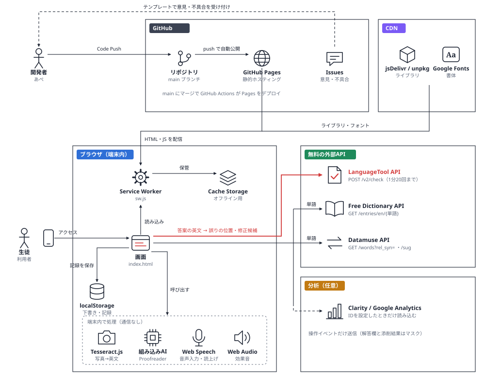
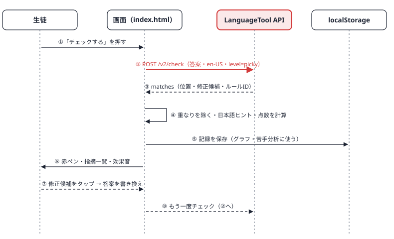

# 英作文添削ノート

英作文を書いて、文法・スペル・語法の誤りを赤ペンでチェックする無料のWebアプリです。登録やAPIキーは要りません。

## できること

- 16のお題（長文・短文・和文英訳）から選んで、英作文を書く
- 文法・スペル・語法・句読点のチェックと、修正候補のワンタップ反映
- 単語をタップして英英辞書を引く（発音記号・例文・似た意味の語）
- 答案や直した文の読み上げ
- 音声での入力、手書き・印刷の答案を写真から読み取る
- 点数の推移と、多いミスの種類のグラフ
- ホーム画面に追加してアプリとして使う（電波がなくても画面は開ける）
- 記録の書き出しと読み込み

## 主な技術スタック

- フロントエンド：HTML / CSS / JavaScript（フレームワークなし）
- 文法チェック：LanguageTool 公開API
- 辞書・類語：Free Dictionary API / Datamuse API
- UI部品：Lucide / Chart.js / canvas-confetti
- 端末内AI：Tesseract.js / Chrome 組み込みAI（Proofreader）
- オフライン：Service Worker / Web App Manifest（PWA）
- ホスティング：GitHub Pages

## 使っている無料のサービス・ライブラリ

| 種類 | 名前 | 用途 |
|---|---|---|
| API | [LanguageTool](https://languagetool.org) 公開API | 文法・スペルチェック |
| API | [Free Dictionary API](https://dictionaryapi.dev) | 英英辞書 |
| API | [Datamuse API](https://www.datamuse.com/api/) | 類語・つづりの候補 |
| ライブラリ | [Lucide](https://lucide.dev) | アイコン |
| ライブラリ | [Chart.js](https://www.chartjs.org) | 記録のグラフ |
| ライブラリ | [canvas-confetti](https://github.com/catdad/canvas-confetti) | 90点以上の演出 |
| 端末内AI | [Tesseract.js](https://tesseract.projectnaptha.com) | 写真の文字読み取り（端末の中で処理） |
| 端末内AI | Chrome の組み込みAI（Proofreader） | 対応するChromeだけ表示されるダブルチェック |
| ブラウザ標準 | Web Speech API | 読み上げ・音声入力 |
| ブラウザ標準 | Service Worker（PWA） | ホーム画面に追加・オフライン |
| ブラウザ標準 | Web Audio API | 効果音（音声ファイルなしで合成） |
| 素材 | [Google Fonts](https://fonts.google.com) | Klee One／Zen Kaku Gothic New／Source Serif 4 |

## 公開のしかた（GitHub Pages）

1. このフォルダの中身をすべて、GitHubのリポジトリに入れる（`.github` フォルダも含めて）
2. リポジトリの Settings → Pages で、Branch を `main`、フォルダを `/ (root)` にして Save
3. 数分後に `https://ユーザー名.github.io/リポジトリ名/` で開けるようになる

アプリを更新したときは、`sw.js` の `VERSION`（`"v1"` → `"v2"`）を上げてください。上げないと、ホーム画面に追加した人に古い画面が残ることがあります。

## 設定（任意）

`index.html` の上の方にある `APP_CONFIG` に書くと、その機能が有効になります。空のままなら何も読み込みません。

```js
window.APP_CONFIG={
  clarityId:"",   // Microsoft Clarity（どこが押されているか・どこで離脱しているか）
  gaId:"",        // Google Analytics（何人が使ったか・どの機能が使われたか）
  feedbackUrl:"", // 意見の受付先。GitHubなら https://github.com/ユーザー名/リポジトリ名/issues/new/choose
  repoUrl:""      // GitHubリポジトリのURL
};
```

- **Microsoft Clarity**：[clarity.microsoft.com](https://clarity.microsoft.com) で無料登録 → プロジェクトを作る → 設定画面のプロジェクトIDを `clarityId` に貼る。答案の欄と添削結果はマスクされ、録画に文章は残りません。
- **Google Analytics**：[analytics.google.com](https://analytics.google.com) で無料登録 → ウェブのデータストリームを作る → 測定ID（`G-` で始まる）を `gaId` に貼る。
- 記録されるイベント：`check`（点数・指摘数）、`voice_input`、`ocr`、`ondevice_ai`、`install`、`export`、`feedback_open`

分析ツールを使うときは、利用者にそのことを伝える一文がページ下部に自動で表示されます。

## 意見をもらう（テスター募集）

- `feedbackUrl` を設定すると、設定画面とページ下部に「意見を送る」が出ます。
- `.github/ISSUE_TEMPLATE` に、意見用と不具合用のテンプレートを入れてあります。GitHubのIssueから選んで書けます。
- テスターにお願いすると良いこと：
  - 実際に英作文を1つ書いてチェックしてもらう
  - 「間違っているのに指摘されなかった」「正しいのに指摘された」例を送ってもらう
  - スマホで迷った場所を教えてもらう

## 注意

- LanguageTool の公開APIは「1分に20回まで」などの制限があり、自動で大量に送る使い方は禁止されています。
- 「チェックする」を押すと、英文は LanguageTool のサーバーに送られます（ページ下部に明記しています）。
- 点数はミスの数から出した目安で、内容や論理は判定しません。

## インフラ構成




